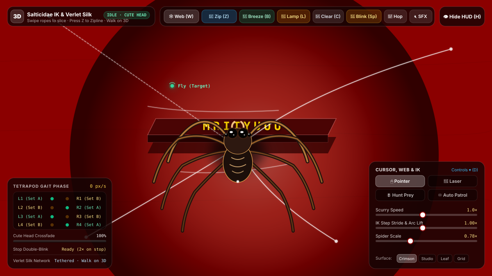
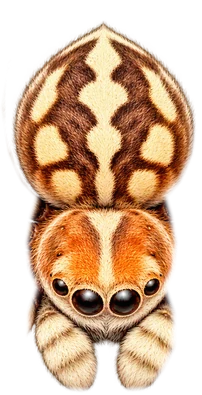
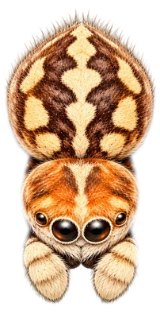
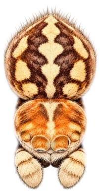

# 🕷️ Mrityuuu — 3D Reactive Jumping Spider & Verlet Silk Web

An interactive, physics-driven 3D web experience built with **Next.js 16 (Turbopack)**, **React 19**, **TypeScript**, **Tailwind CSS v4**, and the **Web Audio API**.

The application simulates a hyper-realistic jumping spider (*Salticidae*) featuring an analytical **2-bone Inverse Kinematics (IK)** solver, alternating **tetrapod gait**, continuous **Verlet silk draglines** with Jakobsen constraint relaxation, interactive 3D extruded collision objects, dynamic desk-lamp spotlighting, and procedural sound synthesis.

---

## 📸 Screenshots & Previews

### Main Experience & Interactive Simulation


### Anatomy & Cutout Rig Architecture


### 3-Photo State Crossfade Engine
| 1. Walking Body Cutout | 2. Cute Head Crossfade | 3. Double-Blink Eyelid Sweep |
| :---: | :---: | :---: |
|  |  |  |
| *Top-down anatomical cutout with isolated carapace, abdomen, and 8 articulated 2-bone legs.* | *Crossfades to forward portrait with glossy eyes when spider ceases locomotion.* | *Socket-clipped furry eyelid sweeps close & open twice in rapid succession on complete stop.* |

---

## 🎮 Controls & Keyboard Shortcuts

All keyboard shortcuts and initial simulation parameters can be customized in [`spider.config.ts`](./spider.config.ts).

### ⌨️ Keyboard Shortcuts Reference

| Action | Default Shortcut | Config Key | Description |
| :--- | :---: | :--- | :--- |
| **Shoot Web** | <kbd>W</kbd> | `shootWeb` | Shoots a Verlet silk rope toward cursor; swipe fast across ropes to slice |
| **Zipline / Rappel** | <kbd>Z</kbd> | `zipline` | Shoots a taut bridge line and ziplines/rappels across the air gap |
| **Spider Hop** | <kbd>J</kbd> | `hop` | Performs an authentic, high-speed jumping spider leap |
| **Double Blink** | <kbd>Space</kbd> | `doubleBlink` | Halts movement, turns cute head forward, and triggers double-blink |
| **Toggle IK Rig** | <kbd>I</kbd> | `toggleIK` | Toggles live 2-bone IK skeleton overlay and Verlet web nodes |
| **Desk Lamp** | <kbd>L</kbd> | `toggleLamp` | Toggles dynamic cursor desk-lamp spotlight and 3D shadows |
| **Ambient Breeze** | <kbd>B</kbd> | `toggleBreeze` | Toggles ambient wind breeze and acoustic web string plucking |
| **Clear Webs** | <kbd>C</kbd> | `clearWebs` | Cleans all spun silk ropes and web network from the canvas |
| **Toggle HUD** | <kbd>H</kbd> | `toggleHUD` | Minimizes or reveals all floating telemetry panels |
| **Audio SFX** | <kbd>M</kbd> | `toggleSound` | Toggles synthesized Web Audio footsteps and silk vibrations |
| **Control Dock** | <kbd>D</kbd> | `toggleDock` | Minimizes or expands the bottom-right controls panel |
| **Anatomy Modal** | <kbd>A</kbd> | `toggleAnatomyModal` | Opens photo cutout rig & gait architecture inspection modal |

---

### 🕹️ Interactive HUD & Modes

#### 1. Tracking Modes (Bottom-Right Panel)
- **🖱️ Cursor Pointer (`cursor`)**: The spider tracks mouse/touch movement with organic acceleration, deceleration, and rotation.
- **🔴 Laser Pointer**: Aggressive predatory stalking mode focused on a red laser dot.
- **🪰 Hunt Prey (`prey`)**: Click anywhere on the table to spawn flies. The spider turns, stalks, and pounces on prey.
- **♾️ Auto Patrol (`patrol`)**: Autonomous Brownian tabletop wandering with smooth edge-avoidance steering.

#### 2. Simulation Sliders
- **Scurry Speed (`0.4× – 2.2×`)**: Dynamically scales forward locomotion velocity.
- **IK Step Stride & Arc Lift (`0.6× – 1.6×`)**: Adjusts leg step reach distance and vertical parabolic step arc height.
- **Spider Scale (`0.45× – 1.35×`)**: Uniformly scales spider body, legs, and drop-shadow radius.

#### 3. Surface Backdrop Themes
- **#8B0000 Crimson**: Default deep vintage leather desktop with desk-lamp lighting.
- **Studio (Obsidian)**: Sleek dark photography backdrop.
- **Leaf (Emerald)**: Natural forest foliage tone.
- **Bark (Sepia)**: Earthy woodland bark.
- **Grid (Blueprint)**: Technical wireframe measurement grid.

---

## ⚙️ Custom Configuration (`spider.config.ts`)

You can modify any keybinding, initial slider value, or physics constant in [`spider.config.ts`](./spider.config.ts) (or via [`config/controls.ts`](./config/controls.ts)):

```ts
import { SpiderControlsConfig } from './spider.config';

export const SPIDER_CONFIG: SpiderControlsConfig = {
  // Rebind any key to your preference
  keybindings: {
    shootWeb: 'w',
    zipline: 'z',
    hop: 'j',
    doubleBlink: 'Space',
    toggleIK: 'i',
    toggleLamp: 'l',
    toggleBreeze: 'b',
    clearWebs: 'c',
    toggleHUD: 'h',
    toggleSound: 'm',
    toggleDock: 'd',
    toggleAnatomyModal: 'a',
  },

  // Initial simulation parameters
  initialSettings: {
    mode: 'cursor',          // 'cursor' | 'patrol' | 'prey' | 'idle'
    speedMult: 1.0,          // Scurry speed multiplier
    strideMult: 1.0,         // Leg stride multiplier
    scale: 0.78,             // Overall spider size
    theme: 'crimson',        // Surface theme
    lampEnabled: true,       // Desk-lamp cursor spotlight
    breezeEnabled: true,     // Ambient wind vibration
    soundEnabled: false,     // Synthesized SFX active on start
    showIK: false,           // 2-bone IK rig skeleton overlay
    hudVisible: true,        // HUD panels visibility
  },

  // Physics constants
  physics: {
    lampRadius: 280,         // Spotlight radius in pixels
    initialBlinkDelayMs: 450,// Delay before startup double-blink
    preySpawnCount: 2,       // Number of initial flies in prey mode
    webGravity: 0.28,        // Sag gravity for Verlet silk nodes
  },
};
```

---

## 🔬 Core Technical Architecture

- **Salticidae IK Engine**: Analytical 2-bone trigonometric inverse kinematics for all 8 legs ($L_1, L_2, L_3, L_4, R_1, R_2, R_3, R_4$) with alternating tetrapod gait sequencing (Set A vs. Set B) ensuring ground stability.
- **Continuous Verlet Silk Draglines**: Multi-node Verlet integration chain with Jakobsen constraint relaxation, catenary sag curves, transverse wave propagation, and cursor intersection rope slicing.
- **3D Extruded Collision Meshes**: The spider detects perimeter boundaries of the 3D extruded **"Mrityuuu"** letters, vintage leather diaries, coffee mug, and pocket watch, stepping up onto their 3D surfaces and tacking down silk.
- **Web Audio API Sound Synthesis**: Procedural sound synthesis (no external MP3/WAV files) using low-pass filtered brownian noise bursts for footsteps, resonant bandpass filters for acoustic silk plucks, and subtle pitch-modulated oscillators for eye-blinks.

---

## 🚀 Getting Started

### Prerequisites
- [Node.js](https://nodejs.org/) (version 18.18 or higher recommended)
- `npm`, `pnpm`, or `yarn`

### Installation
Clone or navigate to the repository directory and install dependencies:
```bash
npm install
```

### Development Server
Run the local development server:
```bash
npm run dev
```
Open [http://localhost:3000](http://localhost:3000) in your browser to interact with the spider.

### Production Build
Build the optimized application with Turbopack:
```bash
npm run build
```
Start the production server:
```bash
npm run start
```

### Linting
Run ESLint to check for code quality:
```bash
npm run lint
```

---

## 📁 Project Structure

```
spider-website/
├── app/
│   ├── globals.css              # Glassmorphism, range sliders, HUD transitions
│   ├── layout.tsx               # Root layout & typography metadata
│   └── page.tsx                 # Dynamic client-only entry point
├── components/
│   ├── spider-engine.js         # Canvas 2D simulation, IK solver, audio, Verlet silk
│   └── SpiderExperience.tsx     # React HUD components, badges, controls, modal
├── config/
│   └── controls.ts              # Re-export alias for spider.config
├── public/
│   └── screenshots/             # Interface previews, SVGs, and photo cutouts
├── spider.config.ts             # Central controls, keybindings, and physics config
├── next.config.ts               # Next.js configuration
├── package.json                 # Project dependencies & build scripts
└── tsconfig.json                # TypeScript compiler configuration
```

---

## 📄 License
MIT License. Created for the **Mrityuuu** interactive 3D spider experience.
